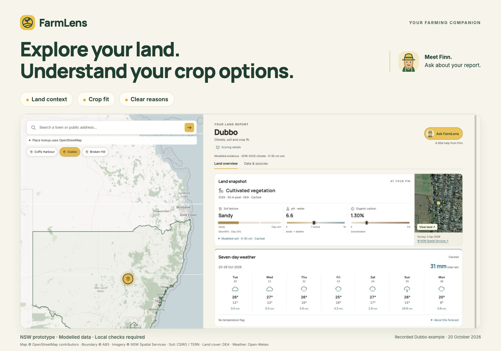
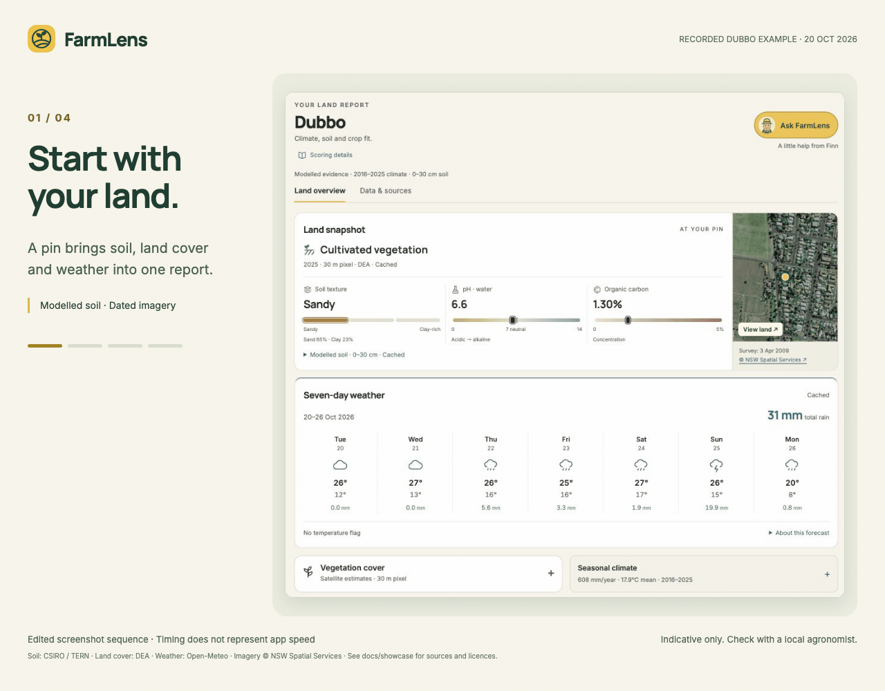

<a id="project-poster"></a>

[](docs/showcase/farmlens-cover.png)

<p align="center">
  <a href="https://www.python.org/"></a>
  <a href="https://developer.mozilla.org/en-US/docs/Web/JavaScript"></a>
  <a href="https://leafletjs.com/"></a>
  <a href="https://streamlit.io/"></a>
</p>

# FarmLens

A friendly farming companion for exploring land in New South Wales. Choose a
point, compare up to three crop candidates, and understand the reasons behind
each score using climate, Australian modelled soil and sourced crop profiles.

**Working local showcase** — no public interactive demo yet. Scores are
provisional screening indices, not planting advice or predictions of yield.

## See it in action

**Dubbo → land context → crop options → factor scores → Finn.**
[Watch the 24-second walkthrough](docs/showcase/farmlens-walkthrough.mp4).

<details>
<summary>Preview the walkthrough here</summary>



</details>

Recorded on 20 October 2026; an edited screenshot sequence, not a live speed test.
Finn uses the local report guide in this example. [Full-size app snapshot](docs/screenshots/showcase-explorer.png).

## What it helps you do

- **Know your land.** Read ten years of climate, a separate seven-day forecast,
  modelled soil and dated imagery in one location report.
- **Compare crop options.** Explore 15 sourced crop profiles with visible factor
  scores, the weakest factor and source-linked NSW checks.
- **Understand the reasons.** Ask Finn supported questions about your report and
  inspect the assumptions behind the shortlist.

Separate water and budget scenarios cover wheat, barley and canola. Optional
OpenAI explanations use approved numeric inputs; they do not set the scores.

## Run locally

Use Python **3.11**. Node.js **22** is needed for frontend tests, not to run the app.

```sh
git clone https://github.com/tuannm3812/FarmLens.git
cd FarmLens
python3.11 -m venv .venv
source .venv/bin/activate
python -m pip install -e '.[dev]'
python -m farmlens.web
```

Open **http://127.0.0.1:8503/**. On Windows, activate with
`.venv\Scripts\Activate.ps1` in PowerShell. Run commands from the repository root;
use the editable install above because the app reads the bundled `web/` and `data/`
folders. This repository is not a standalone wheel distribution.

For the original Streamlit version:

```sh
streamlit run app.py
```

### Prepare a smooth demo

```sh
python scripts/warm_cache.py --skip-fire
```

This fetches real provider data for the three presets and may take several minutes.
For a focused imagery metadata refresh, use `--imagery-only`. The optional
vegetation history uses `--vegetation-only`.

Caches are deliberately excluded from Git. On a fresh clone, turn off
**Cached data only** under **About these inputs & data**, or warm the caches first.
Unavailable inputs remain labelled; the app may withhold a shortlist rather than
invent missing soil measurements. Browser map tiles and imagery can still need
internet in cached mode. The preset coordinates are town-centre examples, not
verified farm paddocks.

## Optional configuration

The main climate, Australian soil and imagery paths need no API key. Use
[`.env.example`](.env.example) as a template; the app reads shell environment
variables and **does not automatically load `.env`**.

| Variable | Purpose |
| --- | --- |
| `OPENAI_API_KEY` and `OPENAI_MODEL` | Optional model-written crop explanations; both required, otherwise local wording is used |
| `FIRMS_MAP_KEY` | Optional NASA FIRMS fire history; missing or incomplete data stays unassessed |
| `NOMINATIM_USER_AGENT` | Application/contact identifier for address and nearby-place lookup |
| `FARMLENS_CACHE_DIR` | Optional local cache directory |

Never commit keys or personal farm information. Guide questions stay in the
browser. The separate model explanation action sends numeric crop/report inputs,
not addresses, coordinates, crop names or the guide conversation. Provider
requests for selected-point data necessarily use location coordinates.

## Methods and limitations

Temperature, rainfall and pH score 100 within each crop's approximate preferred
range, decreasing linearly to zero at the absolute limits. Frost and fire use
explicit demo classes. Texture uses broad preference groups; organic carbon is a
small shared soil-condition proxy. A zero in any assessed factor caps the total
at 20. Missing factors remain unassessed and their weights are excluded.

Weights are centralized in [`farmlens/config.py`](farmlens/config.py). NSW guidance
adds source-linked constraints and unresolved local checks. The data dictionary
records every approximation in [`data/README.md`](data/README.md).

**Limits to keep in mind:** soil is modelled, imagery is dated, crop ranges and
weights are uncalibrated, and scenario inputs are not farm measurements. The
seven-day forecast, imagery, vegetation, water pilot and budgets do not change
crop rankings. Current crop prices and farm-specific yields are not predicted.

## Data sources

| Source | Used for |
| --- | --- |
| [Open-Meteo](https://open-meteo.com/en/docs) | Historical climate, forecasts and water-pilot weather |
| [CSIRO / TERN Soil and Landscape Grid of Australia](https://esoil.io/TERNLandscapes/Public/Pages/SLGA/ProductDetails-SoilAttributes.html) | Modelled soil pH, sand, clay and organic carbon |
| [FAO EcoCrop](https://ecocrop.apps.fao.org/ecocrop/srv/en/home) | Approximate species requirements |
| [NSW agronomy references](docs/research/2026-10-20-nsw-scoring-validation.md) | Local constraints and checks |
| [NSW Spatial Services](https://maps.six.nsw.gov.au/arcgis/rest/services/public/NSW_Imagery/MapServer) | Aerial/satellite mosaic and survey-block dates |
| [Geoscience Australia DEA](https://knowledge.dea.ga.gov.au/) | Land cover and vegetation observations |
| [OpenStreetMap / Nominatim](https://nominatim.org/) | Map context, address search and nearby locality |
| [NASA FIRMS](https://firms.modaps.eosdis.nasa.gov/api/) | Optional historical fire detections |

SoilGrids remains as an earlier tested client; SLGA is the active Australian soil
source. Water coefficients, archived budget examples and provenance are described
in [Methods and limitations](docs/technical-reference.md).

## Check and contribute

```sh
python scripts/check.py
```

This runs Python compilation, pytest, JavaScript syntax checks and Node tests.
Tests use saved fixtures and block live HTTP requests. [GitHub Actions](https://github.com/tuannm3812/FarmLens/actions/workflows/check.yml)
runs the same command. See [CONTRIBUTING.md](CONTRIBUTING.md) for development and
evidence rules, and the [architecture](docs/2_architecture.md) for the app's structure.

```text
farmlens/   Python clients, scoring, scenarios and local API
web/        Custom interface, original SVGs, licensed photos and fonts
data/       Crop profiles, source records and NSW boundary
tests/      Python/JavaScript tests and fixtures
scripts/    Cache warming, checks and demo utilities
docs/       Architecture, methods, source references and showcase media
app.py      Retained Streamlit interface
```

## What comes next

The next substantive milestone is agronomist review and comparison with measured
field data. Public hosting needs a production deployment design: the current
server deliberately binds to localhost and rejects remote origins. Do not expose
it through a tunnel as a public service.

## Licence and credits

Original code and original FarmLens SVG assets are available under [MIT](LICENSE).
Third-party photos, fonts, data and imagery retain their own terms; see
[NOTICE.md](NOTICE.md), the [asset inventory](web/assets/README.md) and
[showcase credits](docs/showcase/README.md).

**Indicative only. Check with a local agronomist.**
