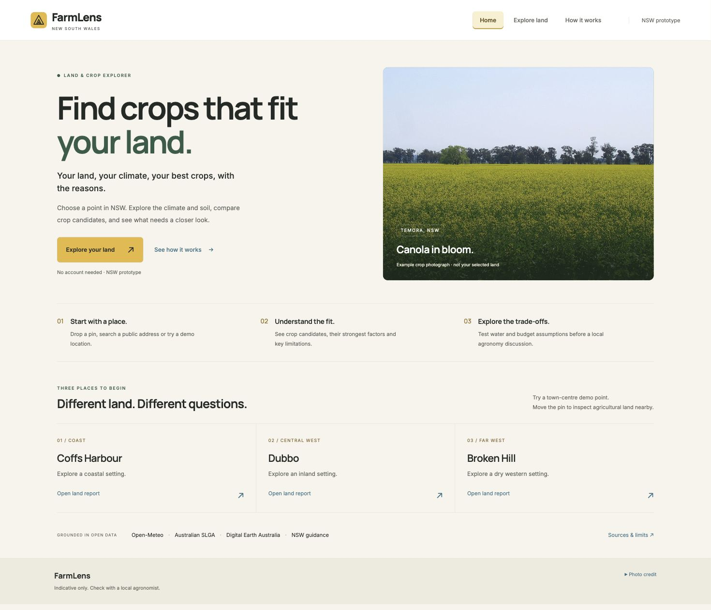
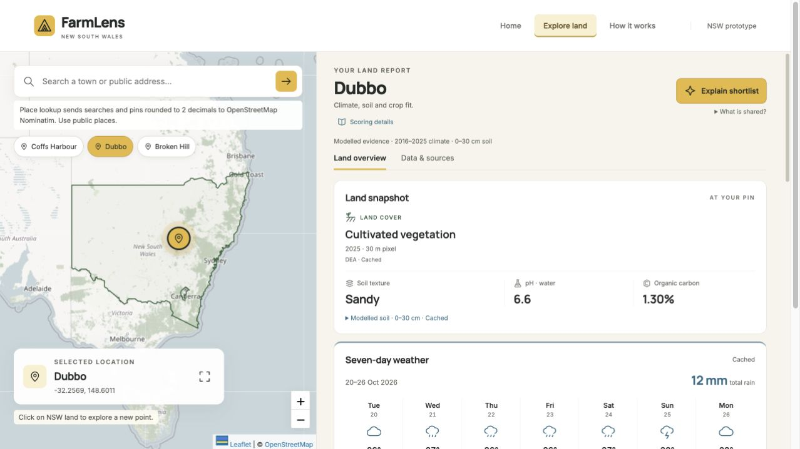
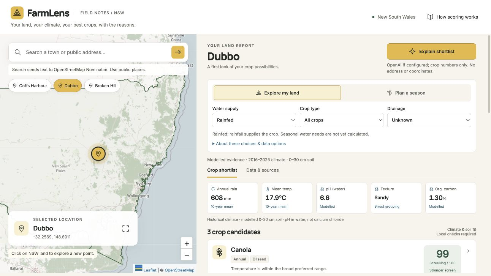
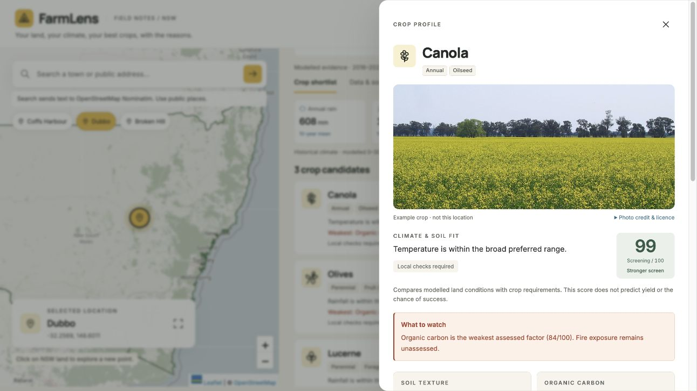
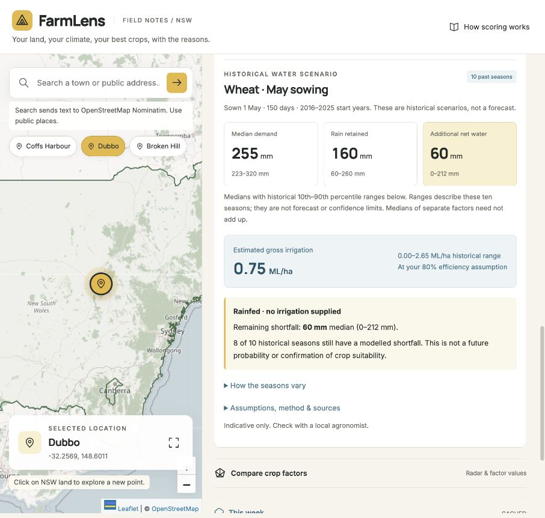
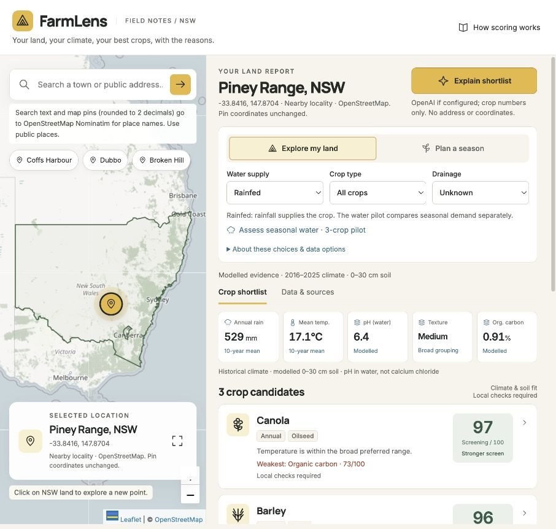
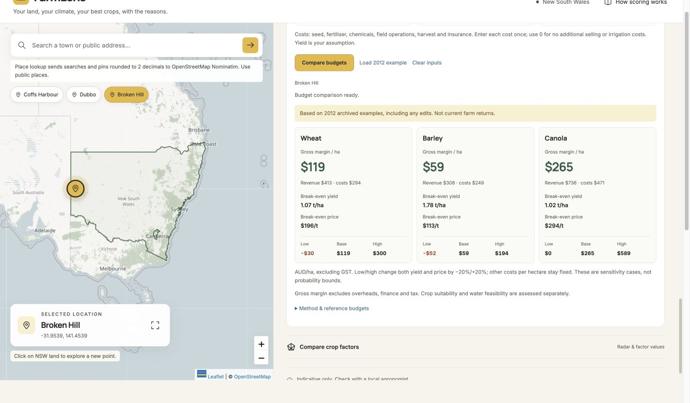
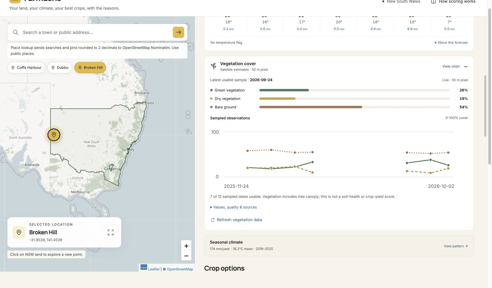

# FarmLens technical reference

This reference preserves detailed implementation notes and historical checkpoints.
Use the [current README](../README.md) for setup and the public project overview.


**Your land, your climate, your best crops, with the reasons.**

A NSW crop suitability demo with a custom local web interface, an optional Streamlit interface, and an interactive map, two screening modes, 15 sourced crop profiles, transparent scores, plain-English explanations, Australian address search and optional historical fire exposure. Scores are provisional environmental screening, not validated planting advice.

## Local showcase — 20 October 2026

The finished local showcase adds a friendly field-and-sprout identity, Finn's
**Ask FarmLens** report guide, a more concise land snapshot and real NSW imagery
at the selected pin. Home, Explore land and How it works share navigation.
The existing crop, water and budget calculations remain separate.

Start with the [current completion checklist](../docs/4_next_steps.md), adopted
[coding standards](../docs/0_coding_standards.md), and [showcase release notes](../docs/showcase/showcase-release-notes.md).
For sharing, use the [LinkedIn image](../docs/showcase/farmlens-linkedin.png),
[post draft](../docs/showcase/linkedin-post.md),
[A3 poster](../docs/showcase/farmlens-showcase-2026-10-20.pdf) and
[speaking script](../docs/showcase/showcase-demo-script.pdf).
The older plans, screenshots and test counts below are historical checkpoints.

Run `python scripts/check.py` for compilation, Python tests, JavaScript syntax
and Node tests. The final local app run passed **305 Python tests and 43 Node
tests**; desktop/mobile flows were checked. GitHub Actions is configured to run
the same command, but no hosted CI run is claimed.

## Setup

```sh
python3.11 -m venv .venv
source .venv/bin/activate
python -m pip install -e '.[dev]'
pytest
python scripts/warm_cache.py
python scripts/demo_rankings.py --output-dir docs/checkpoints
python -m farmlens.web
# Alternative interface:
streamlit run app.py
```

If your `python3.11` shim is broken on macOS, use `/opt/homebrew/bin/python3.11` to create the environment. Tests use saved JSON fixtures (including real SLGA point responses and synthetic edge cases) and block live HTTP calls. The cache script makes real requests for the three presets, prints per-source provenance, and saves only validated API payloads under `cache/`.

The custom app opens its homepage at **http://127.0.0.1:8503/** (change with `--port`). Use **Explore land** or go directly to **http://127.0.0.1:8503/explore** for the map. It serves `web/` and a same-origin JSON API from the existing Python engine. It has no Node build step and adds no Python dependencies. The server binds to loopback only; it is a local demo server, not a public production host. Sites was used in its local workflow; hosting the frontend later requires a reachable backend and deployment hardening.

## Configuration

The climate and soil clients need no keys. Export variables in the shell using `.env.example` as a reference (the app does not automatically load `.env`):

| Variable | Purpose |
| --- | --- |
| `OPENAI_API_KEY` | Optional OpenAI explanation API key |
| `OPENAI_MODEL` | Model available to your account supporting Responses API structured outputs; both model and key are required, otherwise rule-based explanations are used |
| `FIRMS_MAP_KEY` | Optional free NASA FIRMS map key; no key means `fire data not configured` |
| `NOMINATIM_USER_AGENT` | Optional application identifier/contact; defaults to `FarmLens/0.1 (NSW crop screening demo)` |
| `NOMINATIM_URL` | Optional replacement search endpoint; defaults to public Nominatim `/search` |
| `NOMINATIM_REVERSE_URL` | Optional replacement map-pin locality endpoint; defaults to public Nominatim `/reverse` |
| `FARMLENS_CACHE_DIR` | Optional cache directory for the UI; defaults to `cache/` |

Never commit keys. No address, coordinates or crop names are sent to the explanation model; only anonymous indices, numeric inputs, scenario flags and crop scores. Responses use `store=False`, a 20-second timeout and one SDK retry. Successful validated explanations are cached by a hash of numeric inputs, model and prompt. Refusal, invalid output or API failure uses rule-based wording; low-scoring crops retain deterministic caution. The disclaimer is always added locally.

## Presenting the demo

1. Run `python -m farmlens.web` and open http://127.0.0.1:8503/explore. Enable **Cached data only** for a quick presentation. The optional Streamlit interface starts in cached mode. Run `warm_cache.py` first on a new checkout; downloaded caches are intentionally not committed.
2. Choose Coffs Harbour, Dubbo or Broken Hill, click NSW on the map, or submit a public address and select a matching NSW result. Only the selected point is queried. The ABS outline is bundled; map tiles and browser mapping assets still require internet on a cold browser load.
3. Switch between land exploration and a planting-month scenario. Choose rainfed/irrigated and, in exploration, a crop category. Missing monthly history causes seasonal mode to abstain.
4. Inspect crop scores and weakest factors, then press **Ask FarmLens**. Finn answers supported report questions locally. Choose **Explain all crop profiles** inside the panel for the original numeric-only model explanation or rule-based fallback. Both work without a key through local wording.
5. Press **Refresh data** to refresh climate/soil/weather, or turn off cached mode to fetch new points automatically. Australian soil queries run four properties concurrently, each with up to two bounded attempts; source states and timestamps remain visible. Forecast freshness is rechecked on reruns even within the same day.
6. With `FIRMS_MAP_KEY`, press **Load fire history**. Complete cached coverage is used immediately; a first historical fetch requires about 220 five-day intervals per point. The UI gives each fetch a 20-second request budget, reduces request timeouts to the remaining budget and resumes from cached intervals on another click. Network read timeouts limit inactivity, so this is not a guaranteed wall-clock deadline for a server continuously streaming bytes. Until every interval is covered, fire remains unassessed. `warm_cache.py` prefetches this without a total time budget when configured; use `--skip-fire` to skip it.

No server has been publicly deployed.

## Finn and selected-land imagery

Finn uses bounded local rules for crop fit, limitations, soil, water, budgets
and sources. Typed questions stay in the tab and are not sent to OpenAI.
Changing the point or scenario clears previous answers. The optional
**Explain all crop profiles** action retains the numeric-only contract described
above; it does not transmit the guide conversation or change rankings.

The land thumbnail comes from the official
[NSW Spatial Services imagery mosaic](https://maps.six.nsw.gov.au/arcgis/rest/services/public/NSW_Imagery/MapServer).
Its metadata uses the
[survey-block date layer](https://maps.six.nsw.gov.au/arcgis/rest/services/public/NSW_Imagery_Dates/MapServer).
Expand it to inspect the pin, source and date limits. This is dated aerial /
satellite context, not a live image, land-health assessment or property boundary.
The dates verified at the demo pins are Coffs Harbour **7 December 2009**, Dubbo
**3 April 2009**, and Broken Hill **24 July 2013**. Surrounding mosaic pixels can
have different dates.

Date metadata uses a validated 30-day JSON cache at five decimal coordinate
precision, a timeout and one retry. The browser requests the image directly from
NSW Spatial Services with the selected coordinates; it has bounded retries and
an unavailable state. Images and map tiles may require internet even in
**Cached data only** mode. No generated imagery or inferred date substitutes
for a missing result. Run `python scripts/warm_cache.py --imagery-only` to
prefetch the three preset date records.

## Research and two modes

Read the [product, competition and data review](../docs/research/2026-10-20-product-and-data-review.md) for the decisions and remaining validation gaps. This is desk research, not customer research or proof of agronomic accuracy.

- **Explore my land:** compares approximate annual environmental requirements across annual crops, pasture and perennial horticulture. Categories are retained in output and can be filtered.
- **Plan next season:** filters supported annual crops by a selected planting month, then scores temperature and frost using the historical growing-month summaries. Annual rainfall remains an annual screen. Seasonal rainfall and frost/heat-day counts are separate context, not a forecast or a water-balance model.

Both modes accept a rainfed or irrigated scenario. Rice is excluded from this demo's rainfed shortlist. Irrigation does not grant a score bonus because usable water has not been quantified; the irrigated output explicitly requires a water budget. Exact sowing dates, cultivar selection, soil moisture, drainage, salinity and management remain unassessed.

The [step-2 output](../docs/checkpoints/step-2.md) and [18-scenario diagnostic JSON](../docs/checkpoints/step-2-scenarios.json) demonstrate both modes at all three presets. `demo_rankings.py` uses cache-only access and never fetches the network. If historical cache is unavailable, exploration uses labelled regional defaults and seasonal mode abstains because there is no valid monthly history. To prefetch real data first, use `warm_cache.py`.

## Transparent scoring

The [crop CSV](../data/crops.csv) contains 15 EcoCrop-linked profiles; the [data dictionary](../data/README.md) identifies proxy species, calendar sources and unvalidated assumptions. A score is an index, **not a percentage probability of success**.

For temperature, annual rainfall and pH, score 100 within the optimal range, zero at/outside the absolute limits and interpolate linearly between. Frost is a disclosed one-sided cold-month-minimum proxy; fire is a categorical linear penalty with an explicitly assumed sensitivity. Weights live in `farmlens/config.py`: temperature 20%, rainfall 24%, pH 16%, frost 12%, fire 8%, texture 15%, carbon 5%. Texture uses the crop’s verified EcoCrop classes; numeric penalties and broad SLGA grouping remain demo assumptions. Organic carbon is a small shared soil-condition proxy, not crop-specific nutrient sufficiency. The [data dictionary](../data/README.md) defines the exact curves and their limitations. Any assessed zero factor caps the total at 20. Missing fire, texture or carbon is unassessed; omit its weight and renormalize the other weights instead of giving it 100.

Return up to three eligible candidates, their seven sub-scores, total, weakest assessed factor, source and evidence status. Ties are ordered by crop ID; a tied 20-point cap conveys no meaningful preference. An uncalibrated 60-point presentation threshold with no zero factor defines a strong **proxy** match. Below that, output says “No strong match.” Missing soil pH withholds recommendations. Partial soil context or stale inputs are marked provisional. When all assessed factors score 100, the report says there is no assessed limiting factor rather than suggesting the tied factor is a real deficiency.

Important unresolved research finding: global species ranges can rank lentil highly in the Coffs Harbour seasonal scenario despite unassessed local constraints. This result needs agronomic review; it is not a planting recommendation. **Australian SLGA is now integrated**; SILO remains a researched option. pH, broad texture and carbon condition now enter the score. Carbon uses the same small condition curve across crops, and is not a calibrated crop-response model. No empirical accuracy claim or weight calibration has been made.

## Data and calculations

- **[Open-Meteo historical API](https://open-meteo.com/en/docs/historical-weather-api):** daily maximum/minimum air temperatures and precipitation for the last ten complete calendar years, using ERA5 and Australia/Sydney dates. In 2026 this is 2016–2025. Mean annual rainfall is the average of annual totals. Mean annual temperature averages daily `(maximum + minimum) / 2` within each year and then across years. The coldest month is the one with the lowest climatological monthly mean temperature; its mean daily minimum is the frost proxy. The three driest months are the three lowest climatological monthly rainfall totals, not necessarily consecutive. Incomplete daily series and missing values are rejected rather than treated as zero. Historical reanalysis is modelled climate data, not a farm weather-station measurement.
- **[Open-Meteo forecast API](https://open-meteo.com/en/docs):** seven local calendar days including today, total forecast rain and minimum/maximum temperature. Expired cached outlooks retain their actual dates and are labelled stale. Without a usable forecast, the app says the outlook is unavailable; typical climate cannot predict this week's rain.
- **[Australian Soil and Landscape Grid (SLGA)](https://esoil.io/TERNLandscapes/Public/Pages/SLGA/ProductDetails-SoilAttributes.html):** CSIRO / TERN / ACLEP and collaborating Australian agencies, CC BY 4.0. Key-free [CSIRO ArcGIS map services](https://soils.csiro.au/arcgis/rest/services/TERN) provide PHW (pH in water, not CaCl₂), CLY (clay %), SND (sand %) and SOC (organic carbon %). Query only the chosen point at 0–5, 5–15 and 15–30 cm, then weight 5/30, 10/30, 15/30. Native pH is used directly; carbon percent is multiplied by 10 for g/kg. Never apply SoilGrids scaling to SLGA. The ~90 m grid is a spatial model based on historical observations, not a farm soil test or today's measurements. The service aliases do not provide a dependable release date: exact service/layer names and retrieval timestamps are retained without inventing a product vintage. Per-depth lower/upper layers are preserved; the depth-weighted envelope is **not** a joint 90% confidence interval. pH is averaged arithmetically as a screening approximation. Broad texture labels: clay-rich ≥35% clay, sandy ≥65% sand, otherwise medium textured; these are not a full texture classification. Inconsistent clay + sand totals suppress the texture label. Missing pH means no crop shortlist.
- **[ISRIC SoilGrids](https://soilgrids.org/):** the legacy fixture-tested client remains in `farmlens/soil.py` for compatibility; the app, cache warmer and ranking script now use Australian SLGA. The legacy regional soil defaults are not used by the app.
- **[NASA FIRMS](https://firms.modaps.eosdis.nasa.gov/api/area/):** VIIRS S-NPP standard-product detections within 25 km of the rounded point over the last three complete calendar years. Check source date availability first, fetch non-overlapping five-day intervals, validate dates, deduplicate identical location/time/satellite rows and filter by great-circle distance. The API requests a bounding box; only detections within the circle count. Fewer than 10 detections = low, 10–99 = medium, 100+ = high: uncalibrated demo thresholds, not official NASA hazard categories. Clouds, observation gaps and non-wildfire heat sources affect detections; complete API date coverage does not imply complete satellite observation. Detections are not distinct fires, burned area or a prediction of future fire risk. Missing/partial history stays unassessed.
- **[FAO EcoCrop](https://ecocrop.apps.fao.org/ecocrop/srv/en/home):** source for the 15 species' environmental ranges in `data/crops.csv`. Values are approximate for NSW use and do not establish planting dates, irrigation availability or profitability. Each row links to its species sheet; numeric frost/fire penalties and broad calendars are explicitly separate demo assumptions.
- **[Nominatim / OpenStreetMap](https://nominatim.org/):** explicit submitted searches restricted to Australia, then filtered against the NSW polygon. The [usage policy](https://operations.osmfoundation.org/policies/nominatim/) requires an identifying User-Agent, at most one request per second across the application, caching and no autocomplete. FarmLens spaces requests 1.05 seconds apart within its single process, caches searches and supports a replacement endpoint. Run this as a single-process demo; multi-worker/public deployment requires shared throttling or another provider. Do not submit personal or confidential information. Address results are OpenStreetMap data under ODbL and stored locally; failed searches never invent coordinates.
- **[ABS state boundaries](https://geo.abs.gov.au/arcgis/rest/services/ASGS2021/STE/MapServer/0):** bundled 2021 NSW MultiPolygon, CC BY 4.0, converted to WGS84 and simplified with a 0.001-degree maximum offset. The ACT is excluded and Lord Howe Island is included. This approximate screen is not a legal boundary or parcel survey.

The [Australian soil checkpoint](../docs/checkpoints/australian-soil.md) records verified preset values and the ranking comparison. That source-only checkpoint predates soil scoring v2. The [texture and carbon checkpoint](../docs/checkpoints/soil-scoring-v2.md) records the updated shortlist. Neither change is evidence of measured recommendation accuracy.

The [NSW guidance review](../docs/research/2026-10-20-nsw-scoring-validation.md) adds a versioned, source-linked eligibility layer for all 15 crops. Rainfed macadamia below 1,200 mm/year and lentil at or below 300 mm/year are withheld when fresh historical inputs support that check. Reported poor drainage withholds five sensitive crops; it is never inferred from texture. Unknown or incompatible evidence remains unassessed. The seven numeric scores and weights remain uncalibrated; this is guidance consistency, not field validation. See the [scenario checkpoint](../docs/checkpoints/nsw-guidance.md) and [frontend audit](../docs/research/2026-10-20-frontend-audit.md).

## Reliability and provenance

Each requests-based source uses a 5-second connection timeout and 20-second read timeout, with at most one retry (FIRMS reduces timeouts/retries when its request budget runs out). The legacy ISRIC client spaces requests 12.1 seconds apart. The active Australian client queries four property services concurrently and caches each separately. A validated fresh cache avoids unnecessary requests; expired cache is used if refresh fails. JSON cache filenames include source, schema version and latitude/longitude rounded to two decimals for climate and fire. **Australian soil uses six decimals**, avoiding reuse of a different 90 m soil cell within a kilometre-wide two-decimal bucket. Climate keys also include the requested year range. Cache lifetimes: history 30 days, soil 180 days, forecast 4 hours (and only the same forecast start date is considered current). FIRMS availability is cached for one day and historical chunks for one year. Address searches use a query-and-endpoint hash because coordinates are unknown until resolution, with a 30-day TTL. Explanation caches use a numeric-payload/model/prompt hash, without coordinates. Responses contain their original retrieval time. Cache writes are atomic, and read/write failures do not crash clients.

When neither the API nor cache works, **climate only** uses labelled regional demonstration assumptions (nearest preset). Australian soil stays unavailable; missing pH withholds recommendations. These defaults are never written to the real API cache. Unknown properties are never filled with estimated values in the app.

| Climate fallback | Annual rain mm | Mean °C | Coldest-month min °C | Driest 3 months mm |
| --- | ---: | ---: | ---: | ---: |
| Coffs Harbour / coast | 1700 | 19.5 | 8 | 220 |
| Dubbo / central west | 580 | 18 | 3 | 100 |
| Broken Hill / far west | 250 | 19 | 4 | 40 |

Frost labels are approximate: mean minimum ≤2°C = high, ≤5°C = medium, otherwise low. A monthly mean minimum cannot measure the probability of an individual frost event.

## Verification

`pytest` runs offline with **242 passing tests**, covering score limits, climate aggregation, all API clients, geographic exclusions, Streamlit state, explanation fallback/privacy, incomplete fire coverage and stale-session handling. The Australian update adds real SLGA fixtures, unit/depth conversion, missing-data abstention, fine-coordinate cache separation, retry and cache fallback. Live CSIRO queries succeeded for all three presets. Browser checks verified soil evidence, seasonal rankings, explanations, desktop layout and stacked mobile cards with no horizontal overflow; earlier checks exercised address selection and map/preset interaction. OpenAI and FIRMS live responses have not been verified with credentials.

## Demo checkpoints

1. Climate + soil tests and printed preset summaries; stop for review.
2. Approximate crop requirements, transparent weighted scoring, top three per preset; stop for review.
3. Completed: map, location summary and crop cards in Streamlit.
4. Completed: OpenAI explanations with rule-based fallback; no paid live API call was needed for verification.
5. Completed: optional FIRMS client and Australian address search. Nominatim was checked live; FIRMS uses saved synthetic fixtures until a key is configured.

## Custom interface

The custom UI provides a persistent map with search and presets, a compact report panel, expandable crop cards with seven factors, seasonal and water scenarios, detailed source records, and numeric-only explanations. Desktop and mobile layouts use local monochrome SVG icons. Choose “Cached data only” for an offline data demo; external Leaflet assets and map tiles need internet. If the map library fails, presets and address search remain usable. The Python server rejects points outside NSW and cross-origin browser requests. New selections cancel obsolete frontend requests, and explanation requests check that their shortlist and evidence freshness still match the displayed report. Optional reported drainage resets on a new location. Every crop exposes NSW checks, sources and outstanding local questions; withheld candidates retain their reasons.

## Names for selected map points

Clicking the custom map now looks up a nearby locality using [Nominatim reverse geocoding](https://nominatim.org/release-docs/latest/api/Reverse/). The map card, marker title and report heading show the name; the exact selected coordinates remain the inputs to land analysis. A name is nearby map context, not confirmation of a farm address or property boundary. If no locality exists, an available council/area label is used. Missing names remain explicitly unavailable without blocking the crop report.

Only explicit map clicks trigger lookup, after a 450 ms debounce. Nominatim receives coordinates rounded to two decimal places at locality zoom 12; house numbers, roads and private property names are not used as labels. It shares address search's one-request-per-1.05-seconds process-wide limiter, uses a 30-day JSON cache and one retry within the request time budget. Cache-only mode avoids a remote lookup. Late responses cannot rename a new pin, preset or search result. These controls follow the [public Nominatim usage policy](https://operations.osmfoundation.org/policies/nominatim/); keep this a single-process demo.

`NOMINATIM_REVERSE_URL` can replace the reverse endpoint independently of `NOMINATIM_URL` (search). Both use `NOMINATIM_USER_AGENT`. Place labels are OpenStreetMap data under ODbL. Live checks resolved Dubbo and a clicked point near Piney Range; saved fixture tests also cover failures, geographic rejection and cached labels. Desktop and 390-pixel mobile checks showed the name and unchanged coordinates without horizontal overflow.

## Harvest design update

The custom app now uses the Harvest palette (yellow, charcoal and ivory), with local **Manrope** headings and **Inter** body/numerical text. Fonts are served from an explicit asset allowlist; no font CDN is needed at runtime. Licenses and source records are in `web/fonts/`. System fonts cover unavailable glyphs. Streamlit receives the same palette and bundled typography.

The desktop report takes about 60% of the workspace. Explore and Plan a season stay visible, with separate water, crop-type/planting-month and drainage controls. Five land metrics show their historical or modelled context, followed by compact crop cards. A crop opens in a keyboard-accessible side dialog with all seven factor bars and NSW guidance. Explanations appear in that crop profile. On mobile, choosing a point collapses the map and moves focus to the report. Optional radar comparisons preserve missing factors as gaps, use distinct lines/markers, and include a table rounded to one decimal. Chart values are unweighted; crop totals keep their original weights.

Verification: `node --test tests/web_*.test.cjs` passes 20 cases in addition to the 255 Python tests. Browser checks cover drawer focus/Escape, accessible shortlist descriptions, source links, explanations, conditional filtering, drainage reset, mobile overflow, radar and colour/font presentation.

## Crop profiles and asset library

All 15 crop profiles include a real, locally bundled example photograph, its creator/source/licence, and an icon fallback if the image is unavailable. Photos illustrate the species or proxy, not the selected farm. The reusable [asset library](../web/assets/README.md) contains the photo manifest, licensed JPEGs, original monochrome crop symbols and brand mark. Existing local fonts remain in `web/fonts/`. `scripts/fetch_crop_assets.py` can refresh the curated library; no photo network requests are needed at runtime.

Annual/perennial and crop-use tags, colour plus text score states, and separate texture/carbon panels make the profile easier to scan. Experimental carbon points sit inside calculation details and remain explicitly labelled in factor bars. Bars stay primary, with the optional radar comparison retained. Forecast cards show seven-day rain and temperature, with transparent frost/heat thresholds; stale or unavailable forecasts never get a current temperature flag.

The water selector changes the existing irrigation scenario and eligibility checks. Annual rainfall still supplies the crop-score rainfall factor. A separate water-feasibility pilot now explores seasonal water assumptions without changing scoring weights or rankings.

The 15-image library was checked for valid JPEGs, manifest coverage and hashes. Browser verification exercised photo credits, missing-photo fallback and restoration, three presets, seasonal controls, rule-based explanations and a 390-pixel mobile profile with no horizontal overflow.

## Historical water feasibility pilot

In the custom app, choose **Assess seasonal water · 3-crop pilot**, select wheat, barley or canola, review the assumptions, then press **Calculate water scenario**. The panel shows daily-balance demand and additional net water across ten complete historical growing seasons, estimated gross irrigation in ML/ha, and an optional comparison with entered supply. It runs independently of the shortlist; water alone does not establish crop eligibility. It is not a current-season forecast or irrigation schedule.

The source is Open-Meteo ERA5 daily liquid rain and FAO-56 reference ET. Crop coefficients are FAO-derived; local stage timing, storage and efficiency remain unvalidated scenario inputs. Soil water defaults (100 mm buffer / 50 mm starting water) are illustrative and **not derived from SLGA**. Canola's default stage durations are explicit demo assumptions. Blank irrigated supply remains unassessed; rainfed supply is zero. Scores, weights and explanations are unchanged.

Run `python scripts/warm_cache.py --water-only` to prefetch this separate daily history for the three presets. Normal cache warming includes it too. The panel calculates only on request and supports cached data mode, labelled stale-cache fallback and unavailable-data abstention. No new credentials or dependencies are required.

See the [method and limits](../docs/research/2026-10-20-water-method.md), [versioned crop parameters](../data/water_profiles.json) and [preset checkpoint](../docs/checkpoints/water-feasibility.md). The live preset responses were verified. Automated cases cover dates, units, mass balance, rain timing, unknown supply, invalid inputs and obsolete UI responses; they do not establish agronomic accuracy.

Browser checks verified rainfed and unknown/zero/entered irrigation supply, invalid assumptions, location reset, planting-month synchronization, source disclosure and desktop/mobile layouts. A new location clears old results and resets farm-specific assumptions. The crop photo and existing score display still work. Final verification passed all 230 Python tests, 11 JavaScript tests and JavaScript syntax checks.

## Land overview

The **Explore land** page opens with **Land snapshot** and **Seven-day weather**. The snapshot combines dated DEA land cover with the modelled soil texture, pH and carbon values. Weather shows seven actual daily forecasts with WMO condition icons when available; saved forecasts keep their dates and stale labels. Expand **Seasonal climate** for aligned monthly rainfall and temperature charts plus a numeric table. Crop options sit below these cards; water planning, methodology and detailed evidence remain available on demand.

[DEA Land Cover / Geoscience Australia](https://knowledge.dea.ga.gov.au/data/product/dea-land-cover-landsat/) supplies the **2025, 30 m Level 3 pixel classification**, under CC BY 4.0. This is historical land cover, not current land health, a property boundary or permission to cultivate; it is not used in crop scoring. Built-surface and water pixels show a location caution. Missing cover remains unavailable rather than estimated. See the [source verification and preset results](../docs/research/2026-10-20-land-cover.md).

`python scripts/warm_cache.py --land-cover-only` warms this context for all three presets; normal cache warming also includes it. DEA requests are independent of the crop report, use one retry and a validated 30-day cache at five decimal coordinate precision. Other clients retain their documented precision. Scenario changes reuse the same point context, and superseded responses cannot label a different pin. Refresh data also refreshes land cover. Reduced-motion settings suppress card transitions.

The land snapshot now uses compact monochrome icons for land class and soil metrics. Decorative illustrations have been removed from the report, while the observed classification, date, source and land-use warnings remain. The original SVG illustrations are retained in the asset library for other uses. Browse the [local asset gallery](http://127.0.0.1:8503/assets/land-cover/preview.html) or see [asset documentation](../web/assets/README.md).

## Screenshot














Custom UI built using the Sites local workflow, sharing the Python engine with the retained Streamlit app. Monochrome SVG icons are local assets; no icon CDN or new UI framework is required.

Indicative only. Check with a local agronomist.

## Crop budget scenarios

Open **Crop budget** in the custom app to compare wheat, barley and canola using editable yield (t/ha), selling price ($/t), variable costs ($/ha), extra selling costs ($/t), and irrigation costs ($/ha). Blank inputs remain unassessed; enter zero explicitly for a cost that does not apply. Farm assumptions and results clear when the location/scenario is reanalysed.

The panel calculates gross margin per hectare, break-even yield and price, plus sensitivity cases with both yield and price 20% lower/higher. Per-hectare costs stay fixed; per-tonne costs follow yield. **Gross margin is not net profit:** overheads, finance and tax are excluded. Yield is a user assumption; FarmLens does not infer it from soil, satellite cover or the suitability score. The three crops remain in a fixed order, and budgets do not change the shortlist.

**Load 2012 example** is an explicit optional action. Its inputs reproduce archived NSW Central West dryland summaries: [wheat short fallow](https://archive.dpi.nsw.gov.au/__data/assets/pdf_file/0009/386721/dryland-central-west-wheat-shortfallow.pdf), [feed barley](https://archive.dpi.nsw.gov.au/__data/assets/pdf_file/0011/386714/dryland-central-west-barley.pdf), and [conventional canola](https://archive.dpi.nsw.gov.au/__data/assets/pdf_file/0009/386613/dryland-central-west-canola.pdf). Their March 2012 base gross margins are $118.59, $58.86 and $265.39/ha respectively. These are archived examples, **not current returns or point-specific forecasts**. Published variable-cost totals include historical insurance/levies; this simplified calculator holds those totals fixed in sensitivity cases. Update all inputs for farm planning. See the [NSW gross-margin method](https://www.dpird.nsw.gov.au/agriculture/budgets/about) and [ABARES price indicators](https://www.agriculture.gov.au/abares/data/weekly-commodity-price-update/australian-agricultural-prices) for context; indicative market prices are not automatically used as farm-gate prices.

## Satellite vegetation cover

Open **Vegetation cover** below the land snapshot to load real point observations from [DEA Fractional Cover, Landsat](https://knowledge.dea.ga.gov.au/data/product/dea-fractional-cover-landsat/), Geoscience Australia, CC BY 4.0. The panel shows green vegetation, dry vegetation and bare ground at a **30 m pixel**, with the latest usable observation date, a sampled trend and an accessible numeric table. It is distinct from the annual DEA land-cover classification and symbolic land illustration.

The client chooses the last available scene in each month within the preceding year, up to 12 dates. Matching DEA Water Observations flags must indicate clear/dry land at the **same acquisition time**; cloud, shadow, water, missing quality, nodata and out-of-range estimates leave gaps. Clearer scenes earlier in a month can be missed by this bounded sampling approach. Dates use DEA local solar day; acquisition timestamps are retained. Independent cover estimates are not normalised to total 100%. Unmixing error is disclosed rather than presented as a calibrated confidence score. Vegetation can include tree canopy, branches and litter; bare ground includes rock. Cover does not establish soil health, crop yield, farm-wide condition or permission to cultivate, and does not affect scores.

Requests are selected-point only and load on demand. Up to three explicit dates are requested per batch, newest first, with timeouts, one retry and a 55-second request budget. The catalogue caches for seven days and observations for 30 days, at five-decimal coordinates. Validated cached observations remain reusable across catalogue/batch changes. Partial results are labelled; unavailable samples never receive regional estimates. Subsequent requests can fill missing batches. See the [DEA quality-mask method](https://knowledge.dea.ga.gov.au/notebooks/DEA_products/DEA_Fractional_Cover/).

Run `python scripts/warm_cache.py --vegetation-only` before a demo (or add `--refresh` to force retrieval). No new key or dependency is needed. As of 20 October 2026, real usable samples were retrieved for all three presets; availability and dates differ, and initial Dubbo history is partial after service timeouts. The town-centre presets are demonstration pixels, not identified farm paddocks.





Verification for these additions: **287 pytest cases and 28 Node cases pass**, with desktop/mobile browser checks and no console errors. Regression coverage includes gross-margin arithmetic, unknown/zero inputs, matching satellite quality, partial caches, catalogue changes and stale UI responses. These checks validate software behavior, not agronomic or financial forecasting accuracy.

## Homepage and shared navigation

The local site has three pages: **Home** (`/`), **Explore land** (`/explore`) and **How it works** (`/about`). A single server-rendered navigation partial supplies all three, including active-page and keyboard semantics. The homepage introduces the prototype with a credited Temora canola photograph and direct demo links. The method page collects source explanations and limitations. Home/method render without JavaScript or selected-point data requests.

Named links such as `/explore#dubbo` launch fresh preset scenarios; `/index.html` remains an explorer alias. In the same browser tab, returning to the explorer restores the last successfully assessed coordinates, screening mode, planting month, water choice, crop filter, drainage and cache preference. Full address labels, search queries, financial inputs and API keys are not persisted by this feature. Preset names are reconstructed from the preset catalogue; other restored pins receive a generic label. Corrupt or unavailable session storage does not prevent exploration, and the server still validates every point against NSW. Water and budget form assumptions reset when the explorer reloads.

Verification: 293 Python tests and 32 JavaScript tests passed, plus browser checks of all three preset launches, shared navigation, reload/back, scenario restoration, scoring details and 390-pixel mobile layouts. No new dependencies, chatbot, hosting or scoring changes were introduced.
